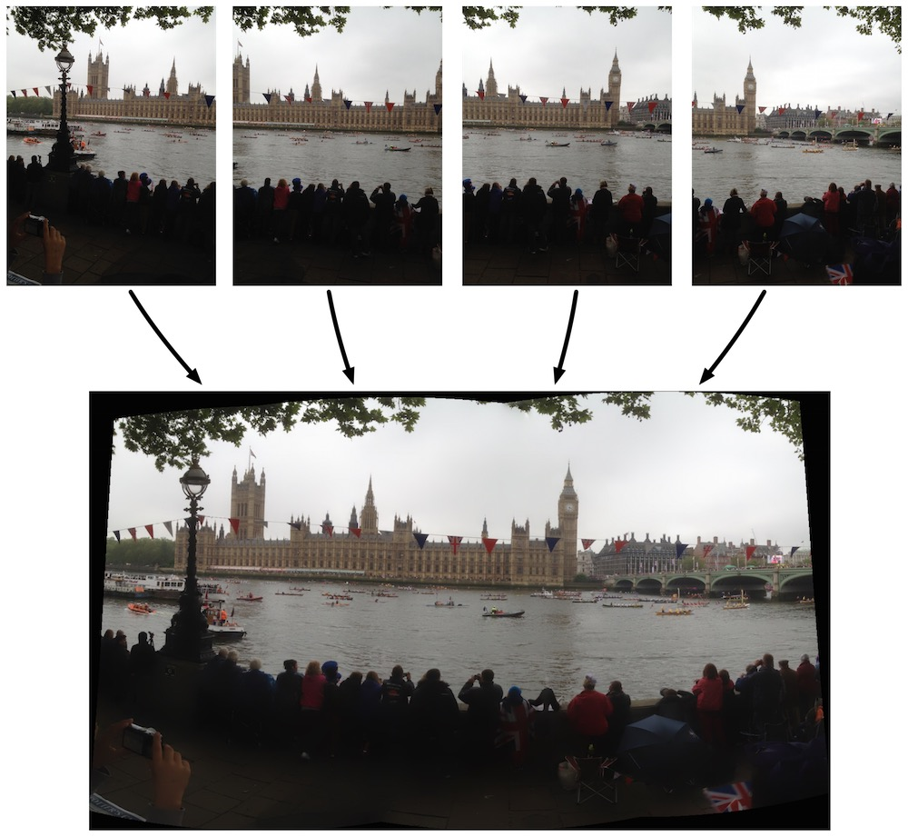

__OpenCV computer vision with iOS: stitching panoramas__  

Version 5.9 of [OpenCVStitch](http://github.com/foundry/OpenCVStitch) 

This update implements **Swift/C++ interoperabilty** as announced at WWDC 2023. Swift now interfaces directly with the C++ OpenCV API. All traces of Objective-C code have been removed.

This project was created to a answer a couple of Stack Overflow questions:  
- [libraries to CAPTURE panorama in iOS](http://stackoverflow.com/q/14062932/1375695)  
- [Can I mix Swift with C++? Like the Objective - C .mm files](http://stackoverflow.com/q/24042774/1375695)    

It demonstrates how to mix Swift and C++ in one project whilst keeping the code clearly separate. 

__Wrapper__ 

For Swift versions < 5.9 an Objective-C wrapper was required to interface between Swift and C++. Swift 5.9 allows us to dispense with Objective-C altogether. Swift can call the C++ APIs in the OpenCV framework directly.

A small C++ wrapper is still used as a workaround for OpenCV API types that can't be accessed directly or are not yet available from Swift. 

__Bridging Header__  
To access the C++ wrapper from Swift in the same module it is imported via a bridging header. 

__Installation__  

[Swift Package Manager](https://github.com/foundry/OpenCVSwiftStitch/releases/tag/5.9-SPM)  
This version imports OpenCV as a Package Dependency from [https://github.com/yeatse/opencv-spm](https://github.com/yeatse/opencv-spm)

The Package will install OpenCV v4.8.1 (or later)

Alternatively, you can manually install the OpenCV framework from [OpenCV.org](https://www.opencv.org)

__Use__  

OpenCVStitch is a very simple iOS/openCV example showing basic use of the Stitcher class. The c++ code is adapted from a sample included with the openCV distribution.  

The app has almost no user interface. On launch, the stitching code operates on four sample images, displaying the result in a UIScrollView.

__OpenCVSwiftStitch Versions__  
[Version 5.9](https://github.com/foundry/OpenCVSwiftStitch/releases/tag/5.9-SPM)
Swift/C++ interop  
OpenCV 4.8.1  
Swift package manager integration  
Tested with XCode 15.0 / Swift 5.9 for iOS 15  
[Version 5.1](https://github.com/foundry/OpenCVSwiftStitch/releases/tag/5.1)  
Swift / Objective-C / C++   
OpenCV 4.3  
Modern Swift - async / await  
Error, exception handling from C++ -> Objective-C -> Swift  
Tested with XCode 13.2 / Swift 5.0 for iOS 13.0+  
[Version 5.0](https://github.com/foundry/OpenCVSwiftStitch/releases/tag/5.0)  
Swift / Objective-C / C++   
OpenCV 4.3  
Tested with XCode 12.0 / Swift 5.0 for iOS 9.0+  
[Version 4.0](https://github.com/foundry/OpenCVSwiftStitch/releases/tag/4.0)   
Swift / Objective-C / C++   
Tested with XCode 10.0 / Swift 4.2 for iOS 8.0+  
[Version 3.0](https://github.com/foundry/OpenCVSwiftStitch/releases/tag/3.0)   
Swift / Objective-C / C++   
Tested with XCode 8.0 / Swift 3.0 for iOS 8.0+  
[Version 2.1](https://github.com/foundry/OpenCVSwiftStitch)   
Swift / Objective-C / C++   
Tested with XCode 7.0 / Swift 2.0 for iOS 7.0+  
[Version 2.0](https://github.com/foundry/OpenCVSwiftStitch/tree/v2.0)   
Swift / Objective-C / C++   
Tested with XCode 6.4 / Swift 1.2 for iOS 7.0+  
[Version 1.0](https://github.com/foundry/OpenCVStitch)  
Objective-C / C++   
Tested with XCode 4.5.2 -> 6.3 for iOS 5.1 upwards   

Provides a partial answer to: [Libraries to capture panoramas in iOS 6](http://stackoverflow.com/questions/14062932/libraries-to-capture-panorama-in-ios-6/14064788#14064788) (Stack Overflow)

__OpenCV Versions__   
_OpenCV 4.8.1_  
The Swift package will bring in the most recent stable version of OpenCV

_OpenCV 4.3_  
The podfile installs OpenCV 4.3  

_this version of OpenCVStitch opted to use cocoapods to overcome the [notorious](http://stackoverflow.com/q/13905471/1375695) [installation](http://stackoverflow.com/q/15855894/1375695) [issues](http://stackoverflow.com/a/14186883/1375695) with previous versions of the framework_

__XCode 15__  

Project is now updated for Swift 5.9 and XCode 15. For backwards compatibility checkout the 2.0 / 2.1 branches, 3.0/4.0/5.0 releases or refer to the Objective-C version v1.0.

__Comparisons__

<table><tr>
<td>OpenCV 2.4.9</td><td>OpenCV 3.0.0</td><td>OpenCV 3.1.0</td><td>OpenCV 4.3.0</td>
</tr><tr>
<td>

</td>
<td>

</td>
<td>

</td>
<td>

</td>
</tr><tr>
<td>

</td>
<td>

</td>
<td>

</td>
<td>

</td>
</tr></table>
